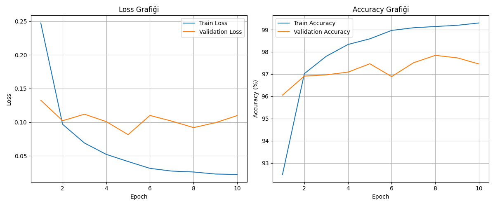
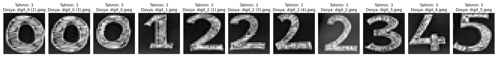

# MNIST Veri Seti ile MLP Tabanlı El Yazısı Rakam Tanıma

Bu projede MNIST veri seti kullanılarak Evrişimli Sinir Ağları (CNN) kullanılmaksızın, Çok Katmanlı Algılayıcı (MLP) mimarisi ile sıfırdan bir derin öğrenme modeli eğitilmiş ve öğrenci numarası el yazısı rakamları üzerinde test edilmiştir.

## 1. Model Mimarisi ve Hiperparametreler
- **Model Türü:** Çok Katmanlı Algılayıcı (MLP)
- **Mimari:** Giriş Katmanı (784) -> Gizli Katman 1 (256, ReLU) -> Gizli Katman 2 (128, ReLU) -> Çıkış Katmanı (10)
- **Kayıp Fonksiyonu:** Cross-Entropy Loss
- **Optimizasyon Algoritması:** Adam (Learning Rate = 0.001)
- **Batch Size:** 64
- **Epoch Sayısı:** 10
- **Veri Kümesi Dağılımı:**
  - Eğitim (Train): 51.000 görüntü (%85)
  - Doğrulama (Validation): 9.000 görüntü (%15)
  - Test: 10.000 görüntü

## 2. Deney Sonuçları ve Başarım Metrikleri
- **Toplam Eğitim Süresi:** 73.94 saniye
- **Son Epoch Eğitim Kaybı (Train Loss):** 0.0224
- **Son Epoch Eğitim Başarımı (Train Accuracy):** %99.30
- **Son Epoch Doğrulama Kaybı (Val Loss):** 0.1099
- **Son Epoch Doğrulama Başarımı (Val Accuracy):** %97.46
- **Nihai Test Başarımı (Test Accuracy):** %97.78

### Eğitim Süreci Grafikleri (Loss ve Accuracy)

## 3. Gerçek Hayat Verisi (El Yazısı Okul Numarası) ile Değerlendirme
Öğrenci numarasına ait rakamlar beyaz kâğıt üzerine elle çizilip fotoğraflanmış; ardından MNIST standartlarına uygun olarak gri seviyeye çevrilmiş, arka plan siyah-yazı beyaz olacak şekilde ters çevrilmiş, 28x28 boyutuna getirilmiş ve normalize edilmiştir.

### Dağılım Kayması (Distribution Shift) ve Model Değerlendirmesi
- Model, MNIST test veri kümesinde **%97.78** gibi yüksek bir başarı elde etmiştir.
- Ancak gerçek hayattaki el yazısı rakamlar test edildiğinde belirli rakamlarda hatalı tahminlerle karşılaşılabilmektedir.
- **Bunun Temel Nedenleri:**
  1. **Uzamsal Bilgi Kaybı (Spatial Hierarchy):** MLP modeli 28x28 boyutundaki iki boyutlu görüntüleri tek boyutlu vektöre düzleştirdiği (`Flatten`) için piksel komşuluklarını ve çizgilerin yapısal ilişkilerini CNN gibi koruyamaz.
  2. **Konum ve Kalınlık Hassasiyeti:** MNIST veri setindeki rakamlar kütle merkezine (center of mass) göre piksellerin ortasına hizalanmış ve standart bir fırça kalınlığına sahiptir. Elle çekilen fotoğraflardaki ufak kaymalar, kalınlık farkları veya açı değişimleri modelin yanılgıya düşmesine neden olur.
  3. **Distribution Shift (Dağılım Kayması):** Eğitim verisinin dağılımı ile gerçek dünya test verisinin dağılımı arasındaki bu fark, derin öğrenmede genelleştirme (generalization) probleminin en temel göstergelerindendir.